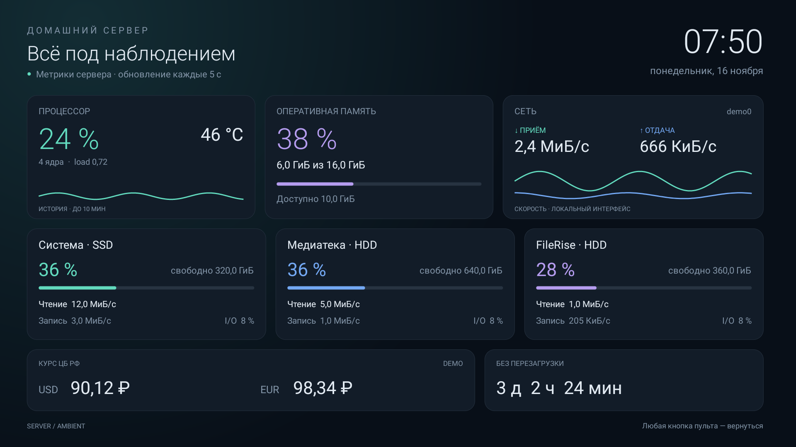
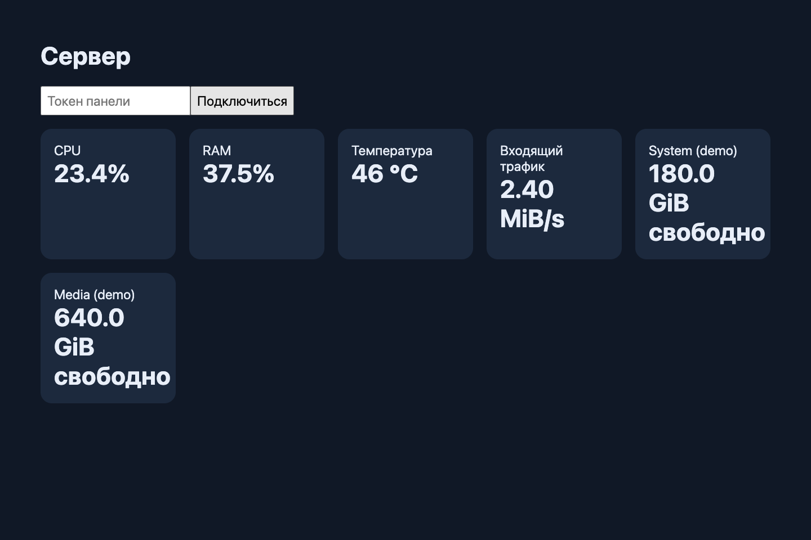

# Living Room Server Dashboard

**English** | [Русский](README.ru.md)

[](https://github.com/ginginohf/living-room-server-dashboard/actions/workflows/tests.yml) [MIT](LICENSE)

Keep an eye on a home server from a television: a native Android TV screensaver, a manual preview activity and a small browser dashboard backed by a read-only metrics collector.

## Ready-to-install Android TV APK

[Download signed APK 1.0.0](https://github.com/ginginohf/living-room-server-dashboard/releases/download/v1.0.0/living-room-server-dashboard-1.0.0.apk) · [Release and SHA-256](https://github.com/ginginohf/living-room-server-dashboard/releases/tag/v1.0.0)

Requires Android TV 8.0+ (API 26). Install the APK, open the app, enter your collector URL ending in `/metrics` and its token, then choose the app as your TV screensaver. See the [Android TV guide](android/README.md). No private endpoint or token is embedded.



Actual signed release APK running on Android TV 12 at 1920×1080. Metrics and exchange rates are synthetic demonstration data.

## What it does

- The Linux collector samples CPU, RAM, uptime, temperature, network throughput and configured disks every five seconds.
- Disk cards include capacity/free space and I/O activity; recent CPU/network history is available to clients.
- The Android TV screen displays clocks, charts and server metrics; enter the metrics URL and token after installation.
- A browser page offers compact cards for a quick check without installing the Android app.
- Optional currency-rate retrieval is disabled by default and can be enabled separately.
- `/metrics` requires a Bearer token. The collector has no server-control endpoint.

## Examples and screenshots

See [worked examples](docs/EXAMPLES.md) for reproducible demonstrations and output. Examples use synthetic data; no private server configuration is included.



## Requirements

Linux/Python 3.11+ for the collector; JDK 17 and Android SDK 34 to build the TV app.

## Quick start

```sh
git clone https://github.com/ginginohf/living-room-server-dashboard.git
cd living-room-server-dashboard
export DASHBOARD_TOKEN="$(python3 -c 'import secrets; print(secrets.token_urlsafe(32))')"
# Loopback is the default; choose a LAN bind address only for trusted clients.
export DASHBOARD_HOST=127.0.0.1
python3 monitor.py
# Open http://127.0.0.1:18737 and enter your token.
# In a separate terminal, to build the TV app:
cd android
./gradlew --no-daemon assembleDebug lintDebug
```

## Configuration and limits

CPU temperature detection targets coretemp; unsupported sensors may show no value. Browser and Android layouts differ. HTTP is for a trusted LAN; use HTTPS when the token needs transport protection. Native client settings are stored in private app preferences, not embedded into the APK. The release APK needs your own signing configuration. The main release screenshot shows the native Android TV app; browser screenshots are labeled separately.

See the [Android TV build and installation guide](android/README.md). Set `DASHBOARD_MOUNTS` to a JSON list of `[path, label]` pairs; the default is the system filesystem. `ENABLE_RATES=1` enables external rate retrieval.

## Tests

```sh
python3 -m unittest discover -s tests -v
```

Install dependencies first when `requirements.txt` is present. See [TESTING.md](TESTING.md) for scope and limitations.

## Documentation

- [Examples](docs/EXAMPLES.md)
- [Recovery and upgrades](RESTORE.md)
- [Security](SECURITY.md)
- [Contributing](CONTRIBUTING.md)
- [Third-party components](THIRD_PARTY.md)

## License

Original project code is available under the [MIT License](LICENSE). Third-party components retain their own licenses.
