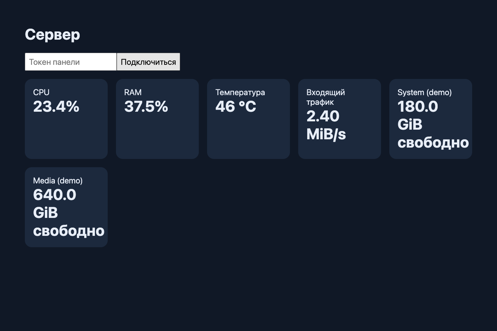

# Visual examples

[Русский](EXAMPLES.ru.md) | [Project overview](../README.md)

The shipped browser dashboard with synthetic CPU, RAM, temperature, network and disk readings. This is the browser companion, not a screenshot of the native Android TV screensaver.



## Reproduce the screenshots

Use a separate tooling environment. The capture script intercepts requests and blocks external hosts; no production server is needed. It renders the actual shipped HTML/CSS/JavaScript rather than a manually drawn mockup.

```sh
python3 -m venv /tmp/ui-capture-venv
. /tmp/ui-capture-venv/bin/activate
pip install playwright
playwright install chromium
python3 examples/capture_ui.py
```

Images are written to `docs/images/`. Alternatively set `DEMO_CHROME` to an existing Chrome executable. Interface labels currently remain Russian; documentation language does not change application localization.
