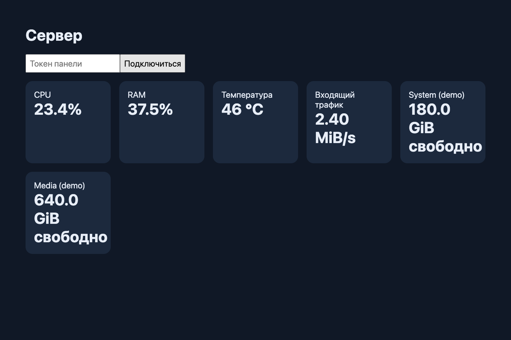
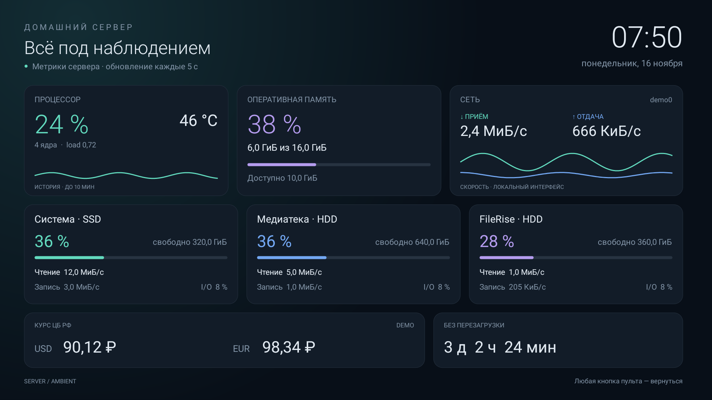

# Визуальные примеры

[English](EXAMPLES.md) | [О проекте](../README.ru.md)

Настоящая браузерная панель с тестовыми CPU, памятью, температурой, сетью и дисками. Это браузерный клиент, не скриншот нативной заставки Android TV.



## Как воспроизвести

Отдельное тестовое окружение; скрипт перехватывает запросы и блокирует внешнюю сеть. Рабочий сервер не нужен. Интерфейс не перерисован вручную.

```sh
python3 -m venv /tmp/ui-capture-venv
. /tmp/ui-capture-venv/bin/activate
pip install playwright
playwright install chromium
python3 examples/capture_ui.py
```

Файлы сохраняются в `docs/images/`. Для установленного Chrome можно задать `DEMO_CHROME` вместо скачивания Chromium. Подписи интерфейса сейчас русские; язык документации не меняет язык приложения.

## Нативная заставка Android TV



Релизный APK установлен в эмулятор Android TV 12 ARM64. Это снимок DreamService через adb screencap; значения демонстрационные, не показатели домашнего сервера.
